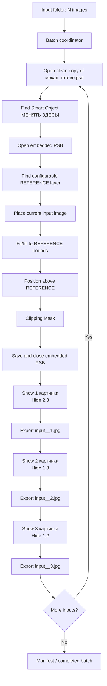

# Исследование готовых MCP и Photoshop-автоматизаций для массового PSD-мокапа

## Резюме

**Вывод:** полностью готового решения, которое из коробки одновременно делает все ваши операции — открывает конкретный вложенный Smart Object, измеряет произвольный нижний слой, подгоняет изображение именно по его bounds, создаёт Clipping Mask, переключает три внешние группы и повторяет это для тысяч файлов — я не нашёл.

Но писать весь пайплайн с нуля **не требуется**.

Наиболее практичная комбинация:

> **`alisaitteke/photoshop-mcp` как основной MCP + готовая логика `joonaspaakko/Batch-Mockup-Smart-Object-Replacement` для batch/nested-target/show-hide + небольшая предварительная подготовка самого PSD.**

Это потенциально позволяет обойтись **без написания нового Photoshop-скрипта вообще**. Основная идея: один раз подготовить внутренний Smart Object так, чтобы placeholder уже находился над нужным reference-layer и уже имел Clipping Mask. После этого runtime-задача перестаёт быть «создай новый слой → вычисли bounds → масштабируй → clip» и превращается в гораздо более стандартное и надёжное **replace/fit existing placeholder**.

Это особенно важно, потому что анализ вашего реального PSD показал, что он уже очень близок к такой структуре.

Я локально проанализировал предоставленный файл `/mnt/data/мокап_готово(1).psd` как PSD-бинарник. Это **не рендеринг Photoshop и не полноценное открытие документа через Photoshop DOM**, поэтому точную связь каждого embedded PSB с внешним экземпляром Smart Object ещё надо подтвердить через Photoshop/MCP. Однако структура уже читается достаточно хорошо:

| Обнаружено в вашем PSD | Результат |
|---|---|
| Размер документа | `1500 × 2000`, RGB, 8-bit |
| Размер файла | около 396 MiB |
| Layer records | 73 |
| Группа | `1 картинка` |
| Группа | `2 картинка` |
| Группа | `3 картинка` |
| Явный Smart Object | `МЕНЯТЬ ЗДЕСЬ!` |
| Его outer bounds | `left=-364, top=428, right=1750, bottom=1972` |
| Smart Objects внутри вариантов | присутствуют несколько экземпляров |
| Clipping Masks | уже активно используются во многих слоях |
| Embedded PSB | обнаружено несколько |

Самое интересное: **один из embedded PSB уже содержит двухслойную структуру**

```text
Прямоугольник 3
Слой 4        [clipping = true]
```

с размером embedded-документа `3190 × 1418`.

Это почти буквально соответствует требуемой конструкции:

```text
NEW IMAGE
   ↓ clipping mask
REFERENCE LAYER
```

Кроме того, внешний `МЕНЯТЬ ЗДЕСЬ!`, `Прямоугольник 3` и некоторые его копии имеют одинаковые outer bounds. Это сильный признак того, что `Прямоугольник 3` может быть именно частью общей mockup-конструкции. **Однако из одного низкоуровневого PSD metadata parsing я не могу доказать, что найденный PSB с `Прямоугольник 3`/`Слой 4` — именно contents слоя `МЕНЯТЬ ЗДЕСЬ!`. Это надо подтвердить одним `photoshop_edit_smart_object_contents` после подключения MCP.**

Главный практический вывод из анализа PSD: **мокап уже устроен гораздо ближе к нужному batch workflow, чем следовало из текстового описания. Возможно, динамическое создание Clipping Mask вообще не понадобится — его можно сохранить как часть template.**

По найденным решениям мой рейтинг такой:

**Основной выбор — [`alisaitteke/photoshop-mcp`](https://github.com/alisaitteke/photoshop-mcp).** Это самый полный, активный и подходящий MCP из найденных: текущая master-документация уже заявляет **122 tools: 106 atomic + 16 recipes**, MIT, macOS/Windows, Photoshop 2012+, Node 18+. Репозиторий активно обновлялся в день исследования, 21 сентября 2026 года. fileciteturn13file0L2-L2 fileciteturn9file0L2-L2 Его присутствие также подтверждается на mcpservers.org и npm. citeturn30search0turn32search0

**Лучший готовый batch engine — [`joonaspaakko/Batch-Mockup-Smart-Object-Replacement-photoshop-script`](https://github.com/joonaspaakko/Batch-Mockup-Smart-Object-Replacement-photoshop-script).** У него есть именно те функции, которых не хватает готовому batch recipe в alisaitteke: `nestedTarget`, resize `fill`/другие режимы, `showLayers`, `hideLayers`, несколько mockup configurations, несколько Smart Objects и hooks для Action/script. fileciteturn21file0L2-L2 fileciteturn22file0L8-L15 fileciteturn23file0L8-L8 fileciteturn24file0L8-L8 Главный минус: GitHub не показывает явной лицензии; код последний раз реально pushed в феврале 2024 года. fileciteturn4file0L2-L2

**Лучший современный альтернативный MCP — [`dcc-mcp/dcc-mcp-photoshop`](https://github.com/dcc-mcp/dcc-mcp-photoshop).** Он значительно моложе, но активно развивается, основан на UXP, имеет Smart Object tools, visibility/export и, главное, raw `batch_play`. Последнее позволяет добраться до Photoshop-функций, которых нет в его typed API. fileciteturn28file0L2-L7 fileciteturn29file1L13-L19 Но я **не рекомендую одновременно управлять одним Photoshop через alisaitteke и DCC-MCP**. DCC здесь лучше рассматривать как альтернативный backend или источник реализации, а не второй параллельный controller.

## Проверка требований и вашего PSD

Ваше требование можно разложить на девять независимых primitives. Это важно, потому что большинство «mockup automation» проектов покрывают только первые и последние операции, но не середину.

| Требование | Насколько сложно найти готовым |
|---|---|
| Открыть PSD | тривиально |
| Найти Smart Object по имени | тривиально |
| Открыть contents Smart Object | доступно |
| Найти вложенный reference-layer | доступно |
| Получить его точные pixel bounds | доступно |
| Place нового изображения | доступно |
| Fit/fill относительно **layer bounds**, не canvas | **основная редкая функция** |
| Сделать Clipping Mask | доступно в alisaitteke |
| Переключить три группы и экспортировать | доступно |
| Повторить N раз без вмешательства | доступно, но качество batch engine сильно различается |

### Что уже подтверждено в вашем PSD

На верхнем уровне действительно присутствуют именно три нужных group records:

```text
1 картинка
2 картинка
3 картинка
```

Также присутствует Smart Object:

```text
МЕНЯТЬ ЗДЕСЬ!
```

То есть configurable layer names в общей системе нужны, но **для вашего текущего template target уже можно задавать буквально как `МЕНЯТЬ ЗДЕСЬ!`**, а variants как три найденных названия.

В PSD есть как минимум несколько слоёв, которые PSD metadata помечает как Smart Objects, например:

```text
МЕНЯТЬ ЗДЕСЬ!
Прямоугольник 3
Прямоугольник 3 копия 4
Прямоугольник 3 копия
Прямоугольник 3 копия 2
Прямоугольник 3 копия 3
Прямоугольник 4 копия
Прямоугольник 5 копия
...
```

Template уже содержит много clipping relationships. Например низкоуровневый `clipping=1` обнаружен у `Слой 80`, `Слой 81`, `Слой 82`, `Слой 87`, `Слой 88`, `Слой 93`, `Слой 94`, а также у некоторых Smart Objects.

Особенно важен найденный embedded PSB:

```text
Embedded PSB
3190 × 1418

Прямоугольник 3
Слой 4      ← clipping = true
```

Это меняет архитектурное решение. Вместо постоянного создания нового clipping relationship на каждой итерации правильнее по возможности **оставить clipping relationship в PSD навсегда и заменять содержимое верхнего placeholder**.

### Два возможных значения «строго привести к размеру»

Здесь есть техническое различие.

Если необходимо сохранить пропорции исходной картинки и полностью закрыть reference-layer:

```text
reference: 500 × 500
input:     5000 × 3000

scale = max(
    500 / 5000,
    500 / 3000
)

→ 833 × 500
→ центрировать
→ clipping mask скрывает 333 px overflow
```

это классический **cover/fill**. Для него `alisaitteke` уже имеет все необходимые primitives: получить bounds, place, uniform scale, move и clipping mask.

Если же слово «строго» означает:

```text
любой input должен стать буквально
width  = reference.width
height = reference.height

даже если aspect ratio меняется
```

то нужен **non-uniform X/Y transform**.

Это единственное существенное ограничение в готовом typed API alisaitteke: его `photoshop_scale_layer` принимает один `scalePercent`, то есть документированный инструмент делает uniform percentage scaling. fileciteturn30file0L2-L14

Сам Photoshop такого ограничения не имеет. Современный UXP DOM умеет layer transforms, а `batchPlay` предоставляет доступ к Photoshop action-командам, не покрытым DOM. Adobe прямо рекомендует сначала DOM, а затем `batchPlay` для недостающей функциональности. citeturn31search9turn31search21

Это значит: **ограничение находится не в Photoshop, а только в конкретном готовом MCP tool surface.**

## Сравнение найденных решений

Обозначения: **Да** — операция явно присутствует; **частично** — можно через более низкий API/Action или не полностью соответствует требованию; **нет** — нужная функция не обнаружена в документированном интерфейсе.

| Проект | License / macOS | Smart Object | Bounds + numeric transform | Clipping Mask | Groups / export | Batch | Вывод |
|---|---|---|---|---|---|---|---|
| **[alisaitteke/photoshop-mcp](https://github.com/alisaitteke/photoshop-mcp)** | MIT; macOS/Windows | **Да:** edit/replace | **Да**, но built-in scale uniform | **Да** | **Да** | **Да**, включая batch mockup recipe | **Лучший основной MCP** |
| **[Joonas Batch Mockup](https://github.com/joonaspaakko/Batch-Mockup-Smart-Object-Replacement-photoshop-script)** | Явная license не обнаружена; JSX работает через Photoshop | **Да**, включая nested target | **Да:** target bounds + fit/fill/xFill | Через Action/hook или pre-clipped placeholder | **Да:** show/hide + output | **Да**, его главная задача | **Лучший готовый batch engine** |
| **[dcc-mcp/dcc-mcp-photoshop](https://github.com/dcc-mcp/dcc-mcp-photoshop)** | README заявляет MIT; UXP, Photoshop 2022+ | **Да** | **Частично:** raw `batch_play` даёт полный Photoshop action surface | Через `batch_play` | **Да** | host/MCP orchestration | **Лучший современный альтернативный backend** |
| **[xKeNcHii/Mockup-Automation-Script](https://github.com/xKeNcHii/Mockup-Automation-Script)** | MIT; есть macOS install | **Да**, но ожидает Smart Object на Layer 1 | Нет generic reference-bounds API | Нет | базовый export | **Да** | Слишком жёсткий для вашего PSD |
| **[SudoMock MCP](https://mcpservers.org/servers/sudomock/mcp-server)** | Cloud/API | **Да**, PSD mockup rendering | Не найдено arbitrary inner-reference fit | Не найдено | render output | **Да** | Не ваш workflow: cloud renderer, а не local Photoshop DOM |
| **MockupBatch / Adobe Exchange** | Marketplace plugin | multiple Smart Object replacement | Не документировано для arbitrary reference-layer | Не подтверждено | batch output | **Да** | Хорош для generic mockups, требования внутри SO не доказаны |
| **StarBoze/Photoshop-MCP-Server** | MIT; заявлен macOS | Photoshop control | различные scripting routes | потенциально | потенциально | заявлен cluster/batch | Слишком незрелый; код почти не развивался после мая 2025 |
| **loonghao photoshop-python-api MCP** | Python/COM | Да | зависит от Photoshop API | потенциально | Да | Да | **Windows-only**, исключается |
| **Editmamei Photoshop MCP** | source-available | macOS route есть | ограниченный набор photo-edit operations | недостаточно документировано | ограниченно | не ориентирован на mockups | Не подходит лучше alisaitteke |

`alisaitteke` сейчас документирует 122 инструмента и прямо позиционируется для macOS/Windows; GitHub master также содержит уже готовые batch recipes. fileciteturn13file0L2-L2 На npm его batch mockup recipe также описан как workflow замены Smart Object для набора assets. citeturn32search0turn32search3 mcpservers.org подтверждает наличие сервера в каталоге, но для точного feature analysis я использовал исходный GitHub, а не только MCP-directory metadata. citeturn30search0

Joonas script непосредственно заявляет batch processing нескольких mockup files и замену нескольких Smart Objects. fileciteturn21file0L2-L2 Его реальный source код показывает `hideLayers`, `resize` с default `fill`, `inputPlaced_runAction` и `inputPlaced_runScript`. fileciteturn22file0L8-L15 В examples `nestedTarget` используется именно как граница для graphics; автор отдельно предлагает превращать placeholder graphic в вложенный Smart Object и использовать его как `nestedTarget`. fileciteturn23file1L19-L24 Это почти идеальное совпадение с вашим lower/reference-layer требованием.

`xKeNcHii` действительно умеет input folder → mockup folder → automatic output и содержит инструкции установки `.jsx` на macOS, но README прямо требует, чтобы Smart Object находился на `Layer 1`. fileciteturn26file0L2-L2 Для вашей нетривиальной PSD hierarchy это слишком узкое предположение.

SudoMock — настоящий MCP для PSD mockup rendering: он принимает PSD templates и генерирует mockup renders. citeturn30search4 Но найденная документация не демонстрирует управление произвольным нижним Photoshop layer, nested PSB DOM и создание Clipping Mask. Поэтому он заменяет Photoshop своим rendering service, а не автоматизирует ваш конкретный Photoshop workflow.

Из Adobe Exchange наиболее релевантен **MockupBatch**: marketplace прямо рекламирует автоматическую замену нескольких Smart Objects в одном mockup. citeturn30search6 Поиск также обнаружил MockCity, Mockup Automator, Mockgo.pro, Mockee и другие bulk-mockup plugins. Их публично индексируемые описания подтверждают generic Smart Object batch replacement, но я не нашёл документированного API для вашего специального шага **«войти внутрь SO → взять bounds соседнего слоя → place → fit → clipping»**. Поэтому считать их полным решением нельзя.

Stack Overflow хорошо показывает типичную проблему generic Smart Object replacement: простая `replaceContents` не решает изменение геометрии произвольных replacement images; один из распространённых ответов предлагает сначала приводить replacement к размеру Smart Object или открывать содержимое SO и работать внутри. citeturn32search1 Это ровно та причина, по которой обычный «bulk Smart Object replacer» недостаточен для вашего требования.

### Почему alisaitteke остаётся лучшей базой

У него уже есть нужные операции почти один в один.

Открытие содержимого Smart Object:

```text
photoshop_edit_smart_object_contents
```

Документация прямо говорит, что active document после этого становится embedded `.psb`. fileciteturn16file0L2-L7

Place внешнего файла:

```text
photoshop_place_image
```

Source описывает `x/y` как absolute canvas coordinates для top-left bounds нового placed layer. Тесты проекта вызывают его так:

```javascript
photoshop_place_image({
    filePath: testPng,
    x: 400,
    y: 200
})
```

fileciteturn18file0L2-L8 fileciteturn18file1L15-L28

Scale:

```javascript
photoshop_scale_layer({
    scalePercent: 150,
    centerAnchor: true
})
```

fileciteturn30file0L2-L14

Создание clipping mask:

```text
photoshop_create_clipping_mask
```

Его source точно определяет семантику: active/named layer становится видим только через opaque pixels **непосредственно расположенного под ним** слоя. fileciteturn31file0L2-L29

Visibility:

```text
photoshop_set_layer_visibility
```

Его наличие проверяется собственным test suite проекта. fileciteturn14file0L8-L13

Также имеются:

```text
photoshop_select_layer_by_name
photoshop_move_layer
photoshop_move_layer_to_position
photoshop_replace_smart_object_contents
photoshop_save_document
photoshop_close_document
photoshop_export_as
photoshop_play_action
photoshop_execute_script
```

`photoshop_play_action` запускает уже записанный Photoshop Action, а `photoshop_execute_script` существует как advanced ExtendScript escape hatch. fileciteturn34file0L2-L16

То есть новый низкоуровневый Photoshop automation framework писать бессмысленно.

### Почему существующего alisaitteke batch recipe недостаточно

Важный момент: `photoshop_recipe_batch_mockup_replace` уже очень близок, но не выполняет ваш workflow полностью.

Его текущий исходник:

```text
directory of assets
    ↓
find Smart Object by exact name
    ↓
replace contents
    ↓
duplicate document flattened
    ↓
save JPEG
    ↓
next asset
```

Он принимает:

```text
smart_object_layer_name
assets_dir
quality
```

поддерживает JPG/JPEG/PNG/TIF/TIFF/PSD/PSB/WebP, не обходит subdirectories и создаёт **один JPEG на один asset**. После batch исходный mockup остаётся с последним вставленным asset. fileciteturn33file0L2-L2

Таким образом, из коробки:

```text
1 asset → 1 output
```

а вам необходимо:

```text
1 asset → SO internal processing → 3 group states → 3 outputs
```

Именно здесь нужен либо Joonas batch engine, либо новый recipe внутри alisaitteke.

## Наиболее близкое к полностью script-free решение

### Вариант с предварительно подготовленным placeholder — рекомендованный

Самый сильный способ **удалить почти всю runtime-сложность** — один раз привести contents `МЕНЯТЬ ЗДЕСЬ!` к такой структуре:

```text
МЕНЯТЬ ЗДЕСЬ!.psb

[INPUT PLACEHOLDER]       ← Smart Object / replaced content
       │
       └── Clipping Mask
             ↓
[REFERENCE]               ← фиксированный lower layer
```

Clipping relationship сохраняется как часть template.

Тогда на каждой итерации уже не требуется:

```text
создать новый layer
найти правильный z-order
создать clipping relationship
```

Остаётся только:

```text
replace/place asset
→ resize/fill relative to placeholder/reference
→ save
```

Именно здесь готовая функция Joonas `nestedTarget` особенно полезна. В example проекта есть:

```javascript
{
    target: '@browser',
    nestedTarget: '@viewport',
    input: '$/_input files/billboard',
    align: 'left top',
    resize: 'xFill'
}
```

fileciteturn23file0L2-L8

Ещё важнее комментарий самого автора: `nestedTarget` используется **как bounds для graphics**, и если нужны bounds исходного placeholder, предлагается превратить placeholder graphic в новый Smart Object и назначить его `nestedTarget`. fileciteturn23file1L19-L24

Это почти готовый ответ на вашу формулировку:

> новая картинка должна автоматически масштабироваться относительно нижнего слоя.

Вместо собственного math-кода используем уже существующую resize logic Joonas.

Проект также уже имеет:

```javascript
resize: 'fill'
```

и source поддерживает callback:

```javascript
inputPlaced_runAction
inputPlaced_runScript
```

fileciteturn22file0L15-L30

Следовательно, если Clipping Mask почему-либо нельзя заранее сохранить в template, можно **один раз записать Photoshop Action `Create Clipping Mask`**, а Joonas вызовет его после каждой вставки. Это **0 строк нового Photoshop-кода**.

### Три варианта тоже уже покрываются Joonas

Его mockup definitions имеют:

```javascript
hideLayers: [...]
showLayers: [...]
```

и это реально используется до replacements. fileciteturn24file0L2-L16

Поэтому можно концептуально определить три jobs на одном template:

```javascript
mockups([
    {
        output: ".../1/",
        mockupPath: ".../мокап_готово(1).psd",
        showLayers: ["1 картинка"],
        hideLayers: ["2 картинка", "3 картинка"],
        smartObjects: [ /* МЕНЯТЬ ЗДЕСЬ! */ ]
    },

    {
        output: ".../2/",
        mockupPath: ".../мокап_готово(1).psd",
        showLayers: ["2 картинка"],
        hideLayers: ["1 картинка", "3 картинка"],
        smartObjects: [ /* тот же input */ ]
    },

    {
        output: ".../3/",
        mockupPath: ".../мокап_готово(1).psd",
        showLayers: ["3 картинка"],
        hideLayers: ["1 картинка", "2 картинка"],
        smartObjects: [ /* тот же input */ ]
    }
]);
```

Это иллюстрация конфигурации на основе реально существующих `output`, `mockupPath`, `showLayers`, `hideLayers`, `smartObjects`; точные nested target names нужно взять после открытия `МЕНЯТЬ ЗДЕСЬ!`. Существующий example показывает именно эти параметры. fileciteturn24file0L2-L16

Получаем:

```text
input A
 ├─ group "1 картинка" → A_1
 ├─ group "2 картинка" → A_2
 └─ group "3 картинка" → A_3

input B
 ├─ group "1 картинка" → B_1
 ├─ group "2 картинка" → B_2
 └─ group "3 картинка" → B_3
...
```

Главный недостаток этого пути не технический, а лицензионный: GitHub repository metadata не показывает явной open-source лицензии. fileciteturn4file0L2-L2 Поэтому для форка/встраивания в коммерчески распространяемый продукт этот проект значительно менее удобен, чем MIT alisaitteke. Для локального рабочего процесса он остаётся очень ценным готовым engine, но нельзя автоматически считать отсутствие LICENSE разрешением на произвольную переработку/распространение.

### Что дают Photoshop Actions без кода

В alisaitteke есть:

```javascript
photoshop_play_action({
    actionName: "My Action",
    ...
})
```

и source явно описывает tool как запуск Action из Photoshop Actions palette. fileciteturn34file0L2-L24

Поэтому такие стабильные операции можно вынести в записанный Action:

```text
move immediately above reference
Create Clipping Mask
save/close SO
```

Но Action не является хорошим решением для вычисления произвольного коэффициента масштаба из размеров разных входных изображений.

То есть:

```text
clipping      → Action подходит
z-order       → Action может подойти
static export → Action подходит

dynamic bounds-based scaling
              → лучше MCP math / nestedTarget / UXP
```

### Когда одного alisaitteke достаточно

Если используется стандартное **cover/fill с сохранением aspect ratio**, никакой Photoshop script не нужен.

После `photoshop_select_layer_by_name(reference)` получаем:

```text
reference:
L, T, R, B

Wr = R - L
Hr = B - T
```

После `photoshop_place_image()`:

```text
placed:
l, t, r, b

Wi = r - l
Hi = b - t
```

Коэффициент fill:

```text
s = max(Wr / Wi, Hr / Hi)
```

Затем:

```text
photoshop_scale_layer(scalePercent = s × 100)
```

и сдвиг к центру reference-layer:

```text
newW = Wi × s
newH = Hi × s

x = L + (Wr - newW) / 2
y = T + (Hr - newH) / 2
```

После этого:

```text
move above REFERENCE
→ photoshop_create_clipping_mask
```

Получается точное cover относительно **конкретного слоя**, независимо от canvas и независимо от исходного разрешения:

```text
500×500
5000×5000
12000×8000
800×1200
...
```

все обрабатываются одной формулой.

То есть при таком толковании вашего требования **alisaitteke уже имеет все необходимые primitives без единой новой строки Photoshop scripting.**

## Рекомендуемая архитектура и интеграция

Для вашего конкретного PSD я бы строил систему в следующем порядке.



### Предпочтительный стек

```text
Codex / Cursor / Claude
          │
          │ MCP
          ▼
alisaitteke/photoshop-mcp
          │
          ├── inspect PSD
          ├── Smart Object operations
          ├── bounds
          ├── place / transform
          ├── clipping
          ├── visibility
          ├── export
          └── Photoshop Actions
                    │
                    ▼
              Photoshop 2025
```

Для high-volume batch можно добавить:

```text
Joonas Batch Mockup engine
          │
          ├── input directories
          ├── loop
          ├── nestedTarget
          ├── resize fill
          ├── showLayers/hideLayers
          ├── output
          └── run Action after placement
```

Не нужно добавлять второй MCP без необходимости.

### Первичная инспекция через alisaitteke

После установки:

```bash
npx -y @alisaitteke/photoshop-mcp
```

или стандартная MCP-конфигурация:

```json
{
  "mcpServers": {
    "photoshop": {
      "command": "npx",
      "args": ["-y", "@alisaitteke/photoshop-mcp"]
    }
  }
}
```

Именно такую установку показывает текущий README. fileciteturn13file0L2-L2

Первый проход:

```text
photoshop_open_image("/.../мокап_готово(1).psd")

photoshop_get_layers()

photoshop_edit_smart_object_contents({
    layer_name: "МЕНЯТЬ ЗДЕСЬ!"
})

photoshop_get_layers()
```

Здесь наконец можно однозначно ответить, соответствует ли найденный мной embedded:

```text
Прямоугольник 3
Слой 4 [clipped]
```

именно `МЕНЯТЬ ЗДЕСЬ!`.

Если да, ваш workflow становится значительно проще.

### Script-free runtime через MCP primitives

Концептуально для одного asset:

```text
select "МЕНЯТЬ ЗДЕСЬ!"
edit_smart_object_contents()

select REFERENCE
read REFERENCE bounds

place_image(asset)

calculate cover/fill percentage
scale_layer(percent)
move_layer(x, y)

move placed layer directly above REFERENCE
create_clipping_mask()

save embedded PSB
close embedded PSB

hide "2 картинка"
hide "3 картинка"
show "1 картинка"
export input__1.jpg

hide "1 картинка"
show "2 картинка"
export input__2.jpg

hide "2 картинка"
show "3 картинка"
export input__3.jpg

close outer PSD without modifying master

next asset
```

Здесь алгоритм фиксирован; LLM не должен каждый раз «решать, что делать». Агенту надо дать один детерминированный workflow и набор configurable names.

### Почему master PSD нельзя постепенно мутировать

Текущий alisaitteke batch recipe прямо указывает в source, что после batch active mockup остаётся с **последним asset placed**. fileciteturn33file0L2-L2

Поэтому безопасный production-pattern:

```text
MASTER.psd
    ↓
fresh working instance
    ↓
asset #1
    ↓
three exports
    ↓
discard working instance

MASTER.psd
    ↓
fresh working instance
    ↓
asset #2
...
```

Либо reopen template на каждом asset, либо сохранять temporary working copy и гарантированно возвращать состояние. Для сотен и тысяч файлов первый вариант проще для recovery: один failed item не загрязняет следующий.

### Naming и resume

Практический output contract:

```text
source:
cat.png

outputs:
cat__1.jpg
cat__2.jpg
cat__3.jpg
```

Batch manifest:

```text
cat.png   → complete → 3 files
dog.png   → complete → 3 files
logo.png  → failed   → reason
```

После crash/restart job проверяет complete transaction из трёх output files.

Это позволяет безопасно обрабатывать:

```text
10     → 30
100    → 300
500    → 1500
10000  → 30000
```

без повторного рендера уже завершённых assets.

### Retry policy

Для одного изображения единицей транзакции должны считаться **все три варианта**.

```text
asset
  ↓
try #1
  ↓ failure
close working docs without save
reopen clean template
  ↓
try #2
  ↓ failure
record error and move to next asset
```

До обработки каждого файла стоит валидировать:

```text
Smart Object "МЕНЯТЬ ЗДЕСЬ!" exists
REFERENCE exists exactly once
group "1 картинка" exists
group "2 картинка" exists
group "3 картинка" exists
input file readable
output directory writable
```

Это особенно важно потому, что lookup по одному имени становится неоднозначным при повторяющихся names. Ваш outer PSD уже содержит повторяющиеся названия вроде `Прямоугольник 4 копия` и `Прямоугольник 5 копия`, поэтому **reference внутри target PSB лучше один раз переименовать в уникальное техническое имя**, например:

```text
__MCP_REFERENCE__
__MCP_INPUT__
```

а внешние names оставить:

```text
__MCP_TARGET__   или существующий МЕНЯТЬ ЗДЕСЬ!

1 картинка
2 картинка
3 картинка
```

Это изменение template, а не написание automation code.

## Альтернативы, остаточный код и окончательная рекомендация

### DCC-MCP как альтернативный backend

[`dcc-mcp/dcc-mcp-photoshop`](https://github.com/dcc-mcp/dcc-mcp-photoshop) оказался более серьёзным проектом, чем я ожидал.

Он использует Photoshop UXP bridge и предоставляет typed tools для документов, layers, Smart Objects, export и raw ActionDescriptors. README описывает Photoshop 2022+, Python package, локальный broker/UXP bridge и CLI/MCP architecture. fileciteturn8file0L2-L2

Для Smart Objects есть реальные implementations:

```text
edit_smart_object_contents
replace_smart_object_contents
convert_to_smart_object
new_smart_object_via_copy
```

fileciteturn29file1L13-L19

Source для `edit_smart_object_contents` существует как отдельный skill, а не только README-заявление. fileciteturn29file0L2-L8

Есть:

```text
set_layer_visibility
export_document
save_document
```

fileciteturn27file0L2-L13

И особенно важен:

```text
batch_play
```

который исполняет raw Photoshop ActionDescriptor commands. fileciteturn28file0L2-L7

Adobe официально описывает `batchPlay` как API, который выполняет один или несколько Photoshop action commands и рекомендует его для функций, которые не покрыты DOM. citeturn31search4turn31search21

Поэтому если выяснится, что alisaitteke не способен сделать один конкретный transform, **DCC-MCP технически может сделать почти всё, что можно записать как Photoshop action descriptor**.

Но это не аргумент запускать оба.

Моя рекомендация:

```text
PRIMARY:
alisaitteke/photoshop-mcp

ALTERNATIVE if UXP/batchPlay becomes necessary:
dcc-mcp/dcc-mcp-photoshop
```

а не:

```text
alisaitteke + dcc simultaneously controlling one document
```

### Готовые проекты, которые не стоит брать как основу

`xKeNcHii/Mockup-Automation-Script` хорош как компактный пример: MIT, GUI input/output/mockup folders, macOS installation и автоматический цикл. Но требование «Smart Object is on Layer 1» показывает, что он рассчитан на намного более простой template. fileciteturn26file0L2-L2

`SudoMock MCP` интересен для SaaS-style mockup generation, но это API renderer, а не локальный Photoshop automation layer. citeturn30search4

`loonghao/photoshop-python-api-mcp-server` исключается для этого MacBook workflow: PyPI/MCP directory реализация построена вокруг Windows Photoshop automation/COM, поэтому добавление её к macOS стеку ничего не даёт.

`StarBoze/Photoshop-MCP-Server` имеет MIT и заявляет cross-platform architecture, но GitHub metadata показывает создание в мае 2025 и последний push 4 мая 2025 года; на момент исследования у проекта только 13 stars и 2 forks. fileciteturn3file0L2-L2 На фоне активно обновляемых alisaitteke и DCC-MCP брать его production foundation нерационально.

### Когда новый код вообще не понадобится

Есть реалистичный **0 LOC new automation code** вариант:

```text
1. Один раз проверить / подготовить target PSB:
   __INPUT__
      clipped to
   __REFERENCE__

2. Использовать существующий clipping relationship.

3. Использовать Joonas:
   nestedTarget = __REFERENCE__/placeholder
   resize = fill

4. Описать template 3 раза:
   show 1 / hide 2,3
   show 2 / hide 1,3
   show 3 / hide 1,2

5. Input = folder.

6. Batch run.
```

Или:

```text
alisaitteke MCP
+
MCP-side calculations
+
existing Photoshop clipping relationship
```

В обоих случаях **новый JSX/UXP script не обязателен**.

Ваш реальный PSD, судя по найденному embedded PSB с уже clipped `Слой 4`, может быть уже подготовлен для первого варианта.

### Если Clipping Mask нельзя заранее сохранить

Следующий по минимальности вариант:

```text
Joonas inputPlaced_runAction
       ↓
Photoshop Action:
"Create Clipping Mask"
```

Joonas source действительно поддерживает `inputPlaced_runAction`. fileciteturn22file0L15-L30

Alisaitteke тоже может запускать Actions через `photoshop_play_action`. fileciteturn34file0L2-L24

Это также **0 LOC**. Action записывается мышкой один раз.

### Если нужен буквально non-uniform exact width/height

Вот тот случай, где я не нашёл verified script-free abstraction в alisaitteke.

Необходимая математика:

```text
refW = ref.right  - ref.left
refH = ref.bottom - ref.top

srcW = src.right  - src.left
srcH = src.bottom - src.top

scaleX = refW / srcW
scaleY = refH / srcH
```

после чего:

```text
scale X independently
scale Y independently
move to ref.left/ref.top
```

Photoshop/UXP способен это сделать; ограничение — только текущий high-level MCP tool. Adobe UXP существует именно для Photoshop automation и `batchPlay` предоставляет advanced fallback. citeturn31search9turn31search21

Минимальный custom UXP helper я оцениваю примерно в **20–40 LOC** для:

```text
get reference bounds
get source bounds
scale X/Y
translate
clipping
```

Полный all-in-one production batch recipe со Smart Object lifecycle, 3 exports, validation и error reporting — примерно **100–180 LOC**, в зависимости от количества ActionDescriptor boilerplate.

Это оценка сложности, а не найденный готовый source.

Псевдокод полного fallback:

```javascript
for (asset of inputFiles) {
    openCleanTemplate();

    target = findLayer(config.targetSmartObject);
    openSmartObject(target);

    reference = findLayer(config.referenceLayer);
    bounds = reference.bounds;

    input = place(asset);

    // Exact stretch:
    scaleX = bounds.width  / input.bounds.width;
    scaleY = bounds.height / input.bounds.height;

    input.scale(scaleX, scaleY);
    input.moveTo(bounds.left, bounds.top);

    input.moveImmediatelyAbove(reference);
    createClippingMask(input);

    saveSmartObject();
    closeSmartObject();

    for (variant of [
        "1 картинка",
        "2 картинка",
        "3 картинка"
    ]) {
        hideOtherVariants();
        show(variant);

        export(
            outputPath(asset, variant)
        );
    }

    closeTemplateWithoutSaving();
}
```

Если нужен **cover с сохранением aspect ratio**, этот custom helper вообще не нужен: uniform `photoshop_scale_layer` alisaitteke уже достаточен. fileciteturn30file0L2-L14

### Итоговый выбор

Для вашего конкретного проекта:

| Приоритет | Решение | Что делать |
|---|---|---|
| **Основной** | **alisaitteke/photoshop-mcp** | Использовать. MIT, активно поддерживается, наиболее полный tool surface |
| **Batch reuse** | **Joonas Batch Mockup Smart Object Replacement** | Использовать существующую логику `nestedTarget`, `resize`, `showLayers`, `hideLayers`; перед распространением учесть отсутствие явной лицензии |
| **0-code clipping** | **Photoshop Action / pre-clipped placeholder** | Предпочтительнее runtime scripting |
| **Alternative MCP** | **dcc-mcp/dcc-mcp-photoshop** | Держать как альтернативу, если понадобится UXP `batch_play` |
| Reference only | xKeNcHii | Не брать как основу |
| Не подходит | SudoMock | Другой execution model |
| Не подходит на Mac | loonghao | Windows/COM |
| Не брать | StarBoze | Слишком слабая зрелость/maintenance |

**Наилучшая архитектура с максимальным reuse выглядит так:**

```text
                     INPUT FOLDER
                          │
                          ▼
              Existing batch coordinator
              Joonas OR deterministic MCP loop
                          │
                          ▼
             alisaitteke/photoshop-mcp
                          │
                          ▼
                    Photoshop 2025
                          │
             ┌────────────┴────────────┐
             │                         │
             ▼                         ▼
       МЕНЯТЬ ЗДЕСЬ!             Outer PSD groups
             │                         │
             ▼                         ├─ 1 картинка → export
       Embedded PSB                    ├─ 2 картинка → export
             │                         └─ 3 картинка → export
       __INPUT__
             │ clipping
             ▼
       __REFERENCE__
```

Ключевое решение здесь не «найти ещё один MCP», а **перенести максимально возможную геометрию и clipping relationship в сам template**. Тогда runtime становится обычным batch content replacement, а именно эту задачу уже хорошо покрывают существующие проекты.

На основании текущего PSD это особенно реалистично: target `МЕНЯТЬ ЗДЕСЬ!`, все три требуемые variant groups и Smart Object/clipping structures уже присутствуют; один embedded PSB уже содержит пару `Прямоугольник 3` + clipped `Слой 4`. Неопределённым остаётся только однозначное сопоставление этого embedded PSB с `МЕНЯТЬ ЗДЕСЬ!` и имя фактического reference layer внутри него. Это единственный существенный структурный пункт, который низкоуровневый анализ PSD не доказал и который следует считать неизвестным до открытия target через Photoshop DOM.