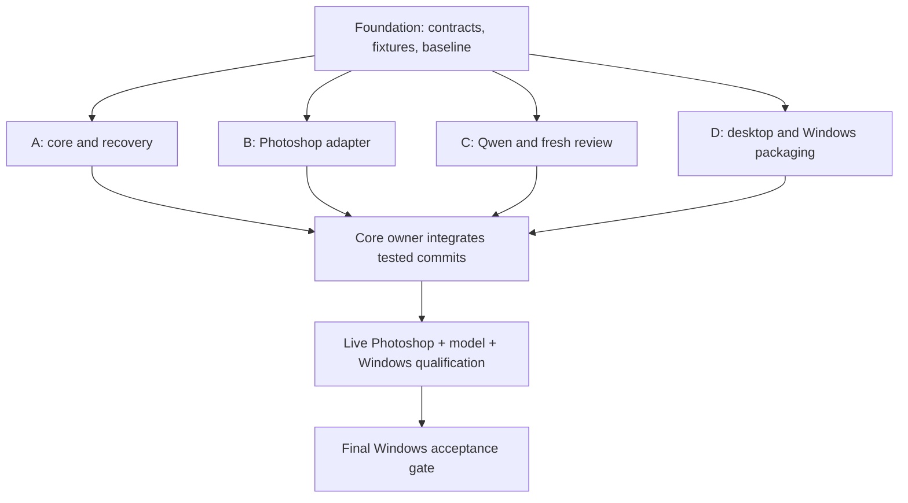

# Parallel implementation and review protocol

## Ordering

Foundation runs once. A/B/C/D start from one recorded commit and use shared fixture contracts. Never start them in the same checkout. Each can finish independently against fakes; only the integration/release stage depends on all four. B is the sole owner of the Photoshop installation lock. Parallel development is permitted; parallel mutation of one Photoshop installation is not.

## Files and changes

| Track | Allowed paths | Contract dependencies |
|---|---|---|
| A | `packages/core`, `tests/core`, `tests/integration`, `docs/qualification`, root config/manifests/lock, CI | All contracts; fake B/C/D until integration |
| B | `packages/photoshop`, `tests/photoshop`, `docs/photoshop` | PhotoshopBackend, RenderRequest, RenderEvidence, InspectionReport |
| C | `packages/intelligence`, `tests/intelligence`, `docs/intelligence`; copy/version operational prompt templates into own package | IntelligenceService, model/review policy and evidence schemas |
| D | `apps/desktop`, `tests/desktop`, `packaging`, `docs/desktop` | JobService, SetupService, snapshots/events; D-owned IPC envelope schemas |

`packages/contracts`, root lockfile and the planning baseline are frozen after foundation. B/C/D must not edit another lane, silently weaken schemas, or change a return type locally. A required shared change is written into the lane's `handoff.md`: old schema, proposed schema, why, consumer impact, migration and test. A reviews it, updates contracts and fixtures in one commit, and tells all affected workers the commit to incorporate. Do not mask mismatches with `any`, unchecked casts or duplicate type definitions.

Use one tracked root lockfile. Package dependency requests go to A; no parallel `npm install` changing the shared lock. Each worktree may `npm ci`. Every branch uses exact pins from foundation. Keep generated runtime data, model weights, source PSD and personal image directories out of commits.

## Development workflow

Implement the lane's bounded tasks, run the named tests, commit only its owned files and record real results, unresolved gates and dependency requests in handoff. Apply task-observer checkpoints. Normal code verification remains; the owner did not request a new reviewer session after every development task. The product reviewer below is the requested layer.

## Runtime image reviewer — requested product layer

Application review runs once per image transaction, before committing the three exports. It uses a fresh local-Qwen request with the literal runtime reviewer prompt, actual source/reference/output images and a sealed evidence packet. The selected reviewer must have qualified vision. Return an individual visual verdict for variants 1,2,3 and publish only if all pass. Prefer the requested Qwen if its exact artifact passes vision qualification; otherwise use an explicitly configured reviewer profile, never a hidden fallback. It has no mutation tools. The same loaded model may serve successive new sessions. Retry never reuses builder history or a previous review verdict as authority. User-launched runtime jobs use the selected qualified Qwen; no automatic cloud fallback.

Model calls in future scheduled jobs/digests must pin `gpt-5.6-luna` at both scheduler and invocation. No other model fallback is permitted. This plan creates no scheduled jobs. Interactive development and owner-launched production batches are distinct from scheduled execution.

## Stable observer storage

All Mac worktrees use `/Users/tsunanory/Desktop/Engines/NE_PSD/skill-observations/observation-log/`. It is project-scoped and does not consolidate observations from other projects. On Windows, record a single canonical checkout anchor before starting workers; reuse it from every worktree. Execute task-observer's storage check, frontmatter scan with independent file count, last-review check and relevant-entry application. Append separate files; do not overwrite another worker's observations. Follow the existing skill's ID/frontmatter rules. No observations is a valid result, but record the checkpoint.

## Completion states

Use `implemented-and-fake-tested`, `live-qualified`, `blocked-external` and `release-qualified` in handoffs. A fake test proves its behavior only. Human-per-asset review is an explicit manual/test mode and does not fulfill the fully automated release requirement. No worker may claim the actual PSD fits correctly, the model is adequate, or Windows installation works without corresponding live evidence. Missing Photoshop blocks B's live gate and final release; it does not block A/C/D development or B's protocol/geometry tests.
